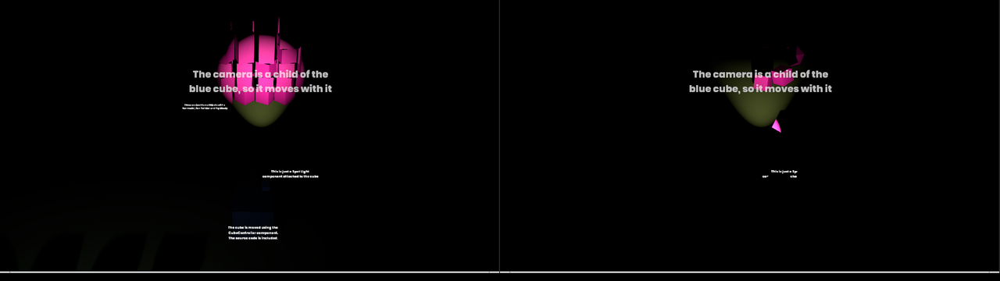
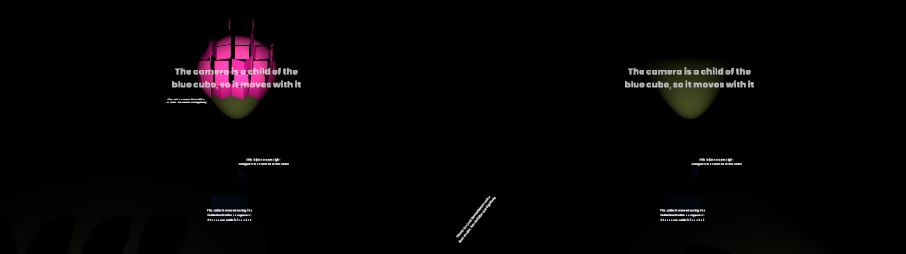

# S&Droid

An s&box editor plugin that exports games for Android and Meta Quest. It builds a signed, zipaligned `arm64-v8a` APK, with the manifest entries Quest 2 / Pro / 3 / 3S need for VR. `Runtime/` holds the work towards running the s&box engine on Android at all.

It's a plugin: it needs an s&box install, not a clone of the engine.

## Install

Copy or clone this repository into your project's `Libraries/` folder, or anywhere the editor loads tool libraries from. Then open **Settings > Android Export...** in the editor.

## Read this first

**s&box doesn't run on Android yet.** The native engine (Source 2) is closed source and ships only for `win64`, `linuxsteamrt64` and `osx`, with no Android or ARM64 build. On Quest, the x86-64 Linux engine has to run under a translator, FEX. VR is OpenXR (through the engine's `Facepunch.XR` layer). Quest's OpenXR runtime is an Android library that an x86-64 glibc process can't load, so immersive VR also needs a bridge.

The exporter does the packaging, the part that works today. The engine runtime it packs is still being built (see [Runtime](#runtime)).

Point **Runtime Directory** at a folder like this:

```
lib/arm64-v8a/libsbox.so          <- loaded by NativeActivity (name = Native Library Name)
lib/arm64-v8a/libopenxr_loader.so <- Khronos loader >= 1.0.34, if not linked statically (VR)
lib/arm64-v8a/*.so                <- everything else the runtime loads
assets/...                        <- optional, merged into the APK (engine core content etc.)
```

## What ends up in the APK

| Path | Content |
|---|---|
| `AndroidManifest.xml`, `resources.arsc` | from `aapt2 link` |
| `lib/arm64-v8a/*.so` | runtime libs, stored uncompressed and page aligned (`extractNativeLibs=false`) |
| `assets/sbox/android.json` | `AndroidRuntimeManifest`: name, ident, package, build date, `IsVRProject` |
| `assets/sbox/game/.bin/*.dll` | the project's compiled assemblies |
| `assets/sbox/game/**` | the project's assets (what `PackageManifest.BuildFromAssets` finds) |
| `assets/**` | the runtime bundle's own assets |

The runtime reads these out of the APK. That contract is the Android counterpart of `StandaloneManifest`.

## Quest manifest

Based on Meta's [native manifest](https://developers.meta.com/horizon/documentation/native/android/mobile-native-manifest/), [OpenXR](https://developers.meta.com/horizon/documentation/native/android/mobile-openxr) and [hand tracking](https://developers.meta.com/horizon/documentation/native/android/mobile-hand-tracking/) pages:

- `android.hardware.vr.headtracking` required, version 1
- launcher categories `com.oculus.intent.category.VR` and `org.khronos.openxr.intent.category.IMMERSIVE_HMD`
- `com.oculus.supportedDevices` from the device checkboxes
- landscape, fullscreen black theme, `singleTask`, non-resizeable activity
- min and target SDK 32 (the **Quest 3 Preset** button sets these)
- optional hand tracking (`oculus.software.handtracking` plus `com.oculus.permission.HAND_TRACKING`), passthrough (`com.oculus.feature.PASSTHROUGH`, optional) and `metavr:uses-metavr-sdk` levels

Not verified against a headset: the passthrough feature name came from a developer forum post rather than Meta's docs, and one third-party guide spells the hand tracking feature `oculus.software.hand-tracking`.

## Requirements

- Android SDK with build-tools (`aapt2`, `zipalign`, `apksigner`) and a platform. Found through `ANDROID_HOME`, `ANDROID_SDK_ROOT` or the default install folders, or set **Sdk Path**.
- A JDK on `PATH` or `JAVA_HOME`, used only to create `~/.android/debug.keystore` if you have no keystore.
- `adb` (SDK platform-tools) for **Export and Run on Device**. On a Quest, turn on developer mode and accept the USB debugging prompt.

## Limits

- Compilation uses the public `EditorUtility.Projects.Compile`, so the whitelist stays on and the `STANDALONE` symbol isn't defined, unlike the Windows exporter.
- Content is deflated into the APK as-is (libraries are stored). Large games need expansion files or asset delivery, which isn't implemented.
- The default signing key is the Android debug key. Store builds need your own keystore (**Keystore Path**, alias and passwords).

## Runtime

`Runtime/` runs the x86-64 Linux engine on Android. Status:

| Where | How | Result |
|---|---|---|
| **arm64 Android 12 app** (Redroid in an arm64 VM) | `Runtime/fex/device-test.sh` with a standalone payload: game through FEX, shown in FEXDroid's X display, Vulkan through FEX's thunks to arm64 lavapipe | **Sweeper renders and plays**: a touch drag turns the cube, W walks it (`android-playtest.sh` passes) |
| **arm64 Android 12 app** (Redroid in an arm64 VM) | `Runtime/fex/device-test.sh`: engine through FEX inside FEXDroid's app sandbox | **dedicated server loads `spacewars`** (`game.load success`, engine at Facepunch master `d3048a7b`) |
| arm64 Linux VM (QEMU, Neoverse-N1) | engine through FEX 2610 | dedicated server loads `spacewars` |
| x86-64 Linux, CPU Vulkan (lavapipe) | `Runtime/linux`: a standalone build, no editor | **Sweeper sample renders and plays**: W/S and mouse look move the cube and its camera |
| x86-64 Android 12L VM (Bliss OS on QEMU) | engine natively, from `adb shell` | dedicated server loads `spacewars` |
| Quest 3 / arm64 phone | `Runtime/fex/device-test.sh` | not run yet |
| inside an app on x86-64 Android | `Runtime/host` | blocked: the app seccomp filter kills glibc's `access()` |

Redroid applies no app seccomp filter, so that pass doesn't cover Android's syscall filtering. On a real device, FEXDroid's patched glibc handles it, and it still needs testing there.

### Test without a device

`Runtime/arm-android-vm/` runs arm64 Android on any x86-64 Linux machine, with no KVM needed. It boots an arm64 Ubuntu VM in QEMU, then runs Redroid (Android in a container) inside it:

Build the payload with `make-payload.sh` first (see [Test on a device](#test-on-a-device)), then:

```sh
Runtime/arm-android-vm/start-vm.sh ~/arm-vm &              # then copy guest-redroid.sh in and run it with sudo
adb connect 127.0.0.1:5556
SBOX_TIMEOUT=10800 SBOX_SCREEN_OFF=1 ADB_SERIAL=127.0.0.1:5556 \
  Runtime/fex/device-test.sh fexdroid-legacy.apk /tmp/sbox-payload
```

Everything runs under software emulation, so it's slow: about 40 minutes to `game.load` on 4 host cores. On real hardware only FEX's 10-20% overhead remains. A log of that run is in `Runtime/results/android12-arm64-redroid.log`.

### Test on a device

A phone with an Adreno GPU, or a Quest 3 in developer mode:

```sh
# on x86-64 Linux (WSL2 works) with s&box's game folder set up, and strace installed
Runtime/fex/make-payload.sh <path to s&box game folder> unittest/addons/spacewars/.sbproj /tmp/sbox-payload
# fexdroid-legacy.apk from https://github.com/cobrabm12/fexdroid/releases (debuggable, carries FEX and an Android-patched glibc)
Runtime/fex/device-test.sh fexdroid-legacy.apk /tmp/sbox-payload
```

Success is a logcat line `game.load success local.spacewars#local`.

### Standalone games on Linux

A device runs a standalone (exported) game. `Runtime/linux` builds one without the editor and plays it headlessly:

```sh
# with engine-patches/ applied to the engine
Runtime/linux/make-standalone.sh <s&box game folder> samples/sweeper /tmp/sweeper
Runtime/linux/play-test.sh /tmp/sweeper   # Xvfb + openbox + lavapipe; holds W, checks the view moved
```

`play-test.sh` passes when the frame isn't blank, idle frames match, and holding the key changes the view. It fails for an unbound key. To run the game yourself: `DOTNET_ROOT=$PWD/bin/dotnet ./sweeper -windowed -vulkan_allow_cpu`. The engine refuses CPU Vulkan devices without `-vulkan_allow_cpu`. Without a window manager, SDL never takes keyboard focus and the game ignores keys. Sweeper's pink surfaces are 4 editor-generated textures the sample doesn't ship (`textures/generated/imagefile/*.vtex_c`).



### Standalone games on Android

A standalone payload makes `device-test.sh` open FEXDroid's display (its Xvfb, copied onto the app's surface) and start the game on it:

```sh
EXTRA_CODE=$PWD/Runtime/linux/probe/InputProbe.cs Runtime/linux/make-standalone.sh <s&box game folder> samples/sweeper /tmp/sweeper
Runtime/fex/make-payload.sh /tmp/sweeper --standalone /tmp/sweeper-payload
SBOX_TIMEOUT=14400 ADB_SERIAL=127.0.0.1:5556 Runtime/fex/device-test.sh fexdroid-legacy.apk /tmp/sweeper-payload
XWD=<arm64 xwd> ADB_SERIAL=127.0.0.1:5556 Runtime/fex/android-playtest.sh /tmp/android-play
```

`android-playtest.sh` plays the game with Android's own input: `input swipe` across the display for mouse look, and `input keyevent` W to walk. The probe compiled into the game reports where the cube is. It passes when the cube turned and then moved, FEXDroid's bridge put new frames on the app's surface, and the X screen changed. On Redroid, the drag turned the cube to yaw -80°, and W moved it by (+97.4, -552.5), which is exactly that heading:



What it took:

- `MESA_VK_WSI_DEBUG=sw`, as FEXDroid sets for its own X clients. Its Xvfb has no DRI3, and without the flag lavapipe's swapchain waits for present events that never come.
- The display screen started cold. FEXDroid's bridge to the screen stops when its screen takes over from another activity, so the game is started with `run-as`, using the environment FEXDroid's command intent reports. `run-as` processes don't get the app's seccomp filter, so a real device still has to confirm the game under FEX inside the app itself. The server run covers that for the engine.
- Under FEX the engine names its log `logs/FEX.log`, after the process.

On the emulated device, loading takes about 10 minutes, and the game then runs at well under 1 fps (lavapipe on 4 emulated cores). Input takes effect frames late. A phone or Quest drops the QEMU layer and renders with Turnip, which FEXDroid picks on Adreno GPUs. Redroid's `screencap` doesn't show FEXDroid's surface, even for FEXDroid's own vkcube. That's why the test dumps the X screen with `xwd` (arm64, for example from Ubuntu's `x11-apps`).

Under FEX, CoreCLR needs both `DOTNET_INTERNAL_ThreadSuspendInjection=0` and `DOTNET_EnableWriteXorExecute=0`. Without them, signal-based thread suspension and double-mapped JIT code crash it during startup. The engine's natives are built with `-mavx`, so any emulator must implement AVX correctly. Google's Android emulator doesn't without KVM.

## Engine patches

`engine-patches/` holds engine fixes found along the way, to be sent upstream to [Facepunch/sbox-public](https://github.com/Facepunch/sbox-public). The plugin doesn't need them:

Rebased onto Facepunch master `9aac470e`:

- Standalone games read their manifest from `standalone.json` where the executable has no PE resources (Linux, Android).
- Standalone games start on Linux. They don't need a menu for the splash screen, and they mount `assets/` by its absolute path.
- Steam rich presence isn't polled, and doesn't throw every frame, when there's no Steam client.
- `SBOX_DUMP_ASSEMBLIES=<dir>` writes compiled game assemblies out, so `make-standalone.sh` can build without the editor.

A fix for the dedicated server throwing on local projects without a `Libraries` folder was also here. Facepunch has since made the same fix upstream. `make-payload.sh` still adds an empty `Libraries` folder for older engines.

## Tests

```sh
dotnet test Tests
```

The tests cover `Code/Core`: settings validation, the manifest, SDK lookup, APK assembly and compression, the runtime bundle, and adb and keytool handling. They need the .NET 10 SDK and no s&box install. `Code/Editor` (the window and the export step) needs the editor runtime and has no automated tests.
